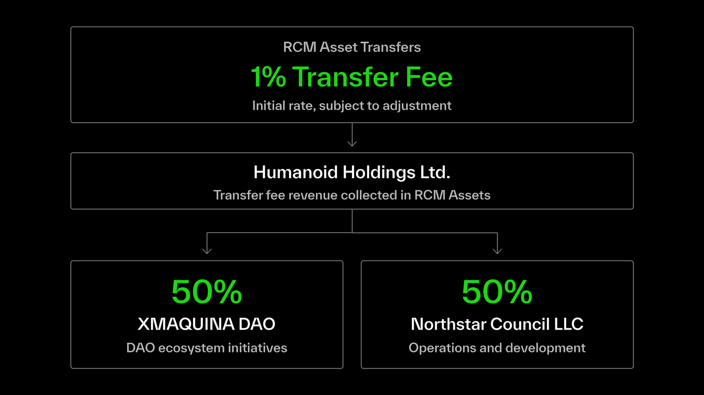

RCM Protocol incorporates a fee structure designed to support access to private robotics investments, ongoing protocol operations and the growth of the XMAQUINA ecosystem.

The protocol generates revenue through primary offerings, RCM Asset transfers and the realization of underlying investments.

## Fee Overview

| Fee | Rate | Application |
| :-- | :-- | :-- |
| Mint Fee | 15% | Gross accepted subscription amount in a primary offering |
| Transfer Fee | Initially 1% | Applicable transfers of RCM Assets |
| Distribution Fee | Up to 3% | Net proceeds from an investment realization |

The applicable fees and their calculation are governed by the Offering Documentation and the terms of the relevant Series.

## Mint Fee

A 15% Mint Fee applies to the gross accepted subscription amount in a primary offering.

The fee is deducted from the accepted subscription amount, with the remaining 85% used to determine the number of RCM Assets allocated to the investor.

For example, assuming an Issue Price of 1.00 USDC per Note:

| Subscription details | Amount |
| :-- | :-- |
| Accepted subscription amount | 10,000 USDC |
| Mint Fee (15%) | 1,500 USDC |
| Net subscription amount | 8,500 USDC |
| RCM Assets allocated | 8,500 |

The Mint Fee supports the structuring, issuance and development of RCM Series, as well as protocol operations and ecosystem growth.

For more information on the subscription and allocation process, see [**Primary Offerings**](https://docs.xmaquina.io/primary-offerings).

## Transfer Fee

RCM Assets incorporate a transfer fee implemented at the token smart contract level.

The initial Transfer Fee is set at 1% of the amount transferred and is collected in the corresponding RCM Assets.

For example:

| Transfer details | Amount |
| :-- | :-- |
| RCM Assets transferred | 1,000 |
| Transfer Fee (1%) | 10 |
| RCM Assets received | 990 |

The Transfer Fee may be adjusted over time, subject to the applicable Series terms and legal requirements.

Certain transfers, including those associated with issuance and settlement, may be exempt from the fee.

## Transfer Fee Revenue Allocation

Transfer Fee revenue is collected by Humanoid Holdings Ltd., the Issuer of RCM Assets, and allocated equally between XMAQUINA Foundation and Northstar Council LLC (Operations SubDAO).

### XMAQUINA DAO

The allocation to XMAQUINA Foundation represents the DAO's share of Transfer Fee revenue, with its use directed by DEUS holders through DAO governance.

As Transfer Fees are collected in RCM Assets, the DAO can accumulate and retain these assets in its treasury, increasing its economic exposure to underlying robotics companies and contribute to the growth of the DAO's Net Asset Value (NAV).

The DAO may also allocate revenue toward initiatives such as:

- DEUS buybacks.
- Staking programs.
- New robotics investments.

The allocation and use of these assets are determined through DAO governance.

### Operations & Development

The allocation to Northstar Council LLC (Operations SubDAO) supports the ongoing operations and development of the XMAQUINA ecosystem, including RCM Protocol.

This includes protocol infrastructure, product development, legal and compliance requirements, and other operational expenses.

This allocation is managed independently by the Operations SubDAO, allowing it to fund ongoing development and operational requirements without requiring individual DAO governance approvals.

## Distribution Fee

A Distribution Fee of up to 3% may apply following a Liquidity Realization Event, as specified in the applicable Series terms.

The fee is calculated on the net proceeds of the underlying investment after applicable taxes, costs, expenses and other deductions.

The remaining amount available for distribution is referred to as Attributable Net Proceeds and is distributed proportionally to recognized Noteholders.

For more information on how investment proceeds are realized and distributed, see [**Realization & Distributions**](https://docs.xmaquina.io/realization-distributions).
