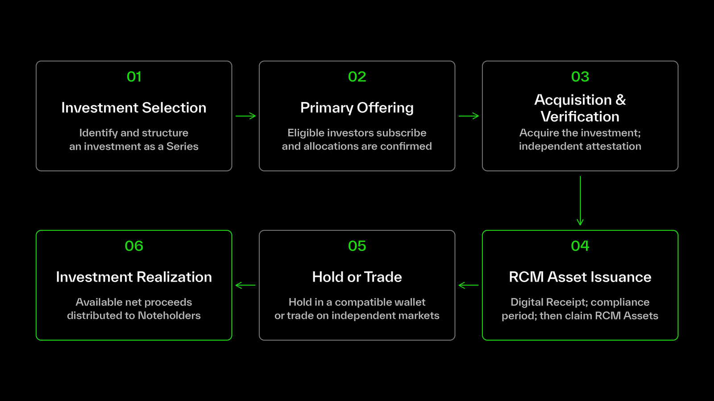

RCM provides a structured framework for bringing private robotics investments onchain, from investment selection and primary offerings to Asset issuance and the distribution of proceeds following an investment realization.

Each investment follows a defined lifecycle under the applicable Series terms.

## The RCM Investment Lifecycle

### 1. Investment Selection and Structuring

An investment opportunity in a private robotics company is identified and structured as an RCM Series.

The underlying investment, acquisition terms, offering size and associated financial terms are established for the Series. Humanoid Holdings Ltd. acts as the Issuer of the corresponding Notes.

For more information, see [**Protocol Architecture**](https://docs.xmaquina.io/protocol-architecture?utm_source=chatgpt.com).

### 2. Primary Offering

Eligible investors participate in the Series through a structured primary offering.

Investors complete the applicable eligibility and verification requirements, enter into a subscription agreement and submit their subscription in USDC.

Following the close of the offering, the Issuer confirms accepted allocations in accordance with the applicable Series terms.

For more information, see [**Investor Eligibility**](https://docs.xmaquina.io/investor-eligibility?utm_source=chatgpt.com) and [**Primary Offerings**](https://docs.xmaquina.io/primary-offerings?utm_source=chatgpt.com).

### 3. Investment Acquisition and Verification

The Issuer uses the allocated investment capital to acquire the underlying investment associated with the Series.

The completed acquisition is independently verified through a third-party investment attestation, with supporting investment information made available through the [RCM platform](https://rcm.xmaquina.io/).

### 4. RCM Asset Issuance

Each accepted subscriber's allocation is recorded onchain against their designated wallet, representing their entitlement to claim RCM Assets upon issuance.

Following the applicable Distribution Compliance Period and completion of the required Issuer checks, investors can claim their RCM Assets.

The corresponding Notes are recorded in the Securities Ledger under the Swiss ledger-based securities framework.

For more information, see [**Understanding RCM Assets**](https://docs.xmaquina.io/understanding-rcm-assets?utm_source=chatgpt.com).

### 5. Holding and Secondary-Market Trading

Once transferable, RCM Assets can be held in compatible blockchain wallets, transferred permissionlessly and traded on independent secondary markets.

The underlying investment remains held by the Issuer, while the contractual economic rights associated with the Notes transfer through the Securities Ledger.

Secondary-market prices are determined independently and may trade above or below the published NAV of the Asset.

For more information, see [**Secondary Markets**](https://docs.xmaquina.io/secondary-markets?utm_source=chatgpt.com) and [**NAV & Market Pricing**](https://docs.xmaquina.io/nav-and-market-pricing?utm_source=chatgpt.com).

### 6. Investment Realization and Distributions

When the underlying investment is realized through a sale, acquisition or other applicable liquidity event, the resulting proceeds are applied in accordance with the Series terms.

Available net proceeds are distributed proportionally to Noteholders, subject to the applicable holder determination and verification requirements.

For more information, see [**Realization & Distributions**](https://docs.xmaquina.io/realization-distributions?utm_source=chatgpt.com).

## Series-Specific Terms

Each RCM Series has its own underlying investment, offering terms, issuance arrangements and distribution conditions.

While each investment follows the common RCM framework, the specific terms governing the investment are established in its applicable offering documentation.
