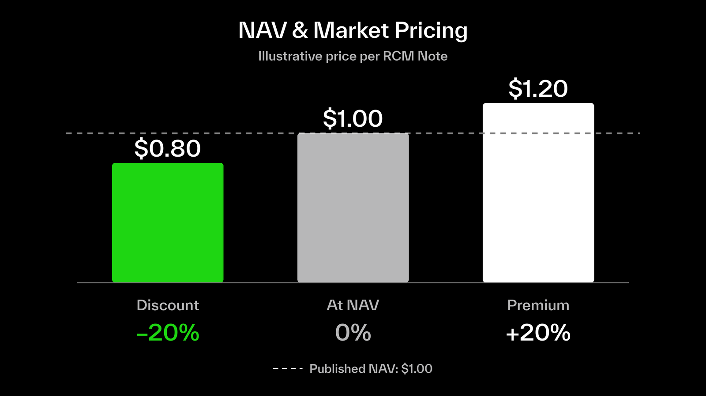

The RCM platform provides valuation and market pricing information to help investors assess the value of their RCM Assets and their exposure to the underlying investment.

## Investment Valuation

Each RCM Series is associated with a specific underlying investment.

The RCM platform provides relevant investment and valuation information, including the acquisition share price, indicative entry valuation and historical financing rounds.

This information helps investors evaluate the investment opportunity and understand the valuation at which they gain economic exposure to the underlying company.

For more information, see [**Primary Offerings**](https://docs.xmaquina.io/primary-offerings).

## Net Asset Value (NAV)

NAV represents the estimated value of the underlying investment attributable to each Note. It provides a reference for investors to assess the value of their investment independently of the secondary-market price.

NAV is calculated by dividing the assessed value of the underlying investment, less applicable liabilities, by the total number of outstanding Notes.

**NAV per Note = Net value of Series assets ÷ Outstanding Notes**

NAV is updated when new valuation information is confirmed, such as a new financing round. The updated valuation takes into account the company's capitalization structure and the rights associated with the shares held by the Issuer.

The RCM platform displays the NAV per Note, together with the applicable valuation date and valuation basis.

NAV is an indicative estimate. It does not represent a guaranteed redemption value or the amount that will ultimately be realized from the underlying investment.

## Secondary-Market Price

Once RCM Assets become transferable, they can be traded on independent secondary markets.

Market prices are determined by supply and demand, available liquidity and trading activity.

Unlike NAV, which provides a valuation reference based on the underlying investment, market prices may fluctuate continuously as trading occurs.

The RCM platform displays independent market pricing where available.

For more information, see [**Secondary Markets**](https://docs.xmaquina.io/secondary-markets).

## Premiums and Discounts to NAV

RCM Assets may trade above or below their published NAV.

- Discount: The market price is lower than NAV.
- At NAV: The market price is equal to NAV.
- Premium: The market price is higher than NAV.

For example:

| NAV per Note | Market Price | Premium / Discount |
| :-- | :-- | :-- |
| \$1.00 | \$1.20 | 20% premium |
| \$1.00 | \$1.00 | 0% |
| \$1.00 | \$0.80 | 20% discount |

The premium or discount helps investors compare the current market price of an RCM Asset with its published NAV.

## Investment Value and Realization

Neither NAV nor the secondary-market price represents a guaranteed return or the amount investors will receive upon realization of the underlying investment.

Actual distributions depend on the proceeds realized from the underlying investment, after applicable fees, expenses and any other deductions in accordance with the Series terms.

Holders do not have the right to redeem their RCM Assets at NAV.

For more information, see [**Realization & Distributions**](https://docs.xmaquina.io/realization-distributions).
