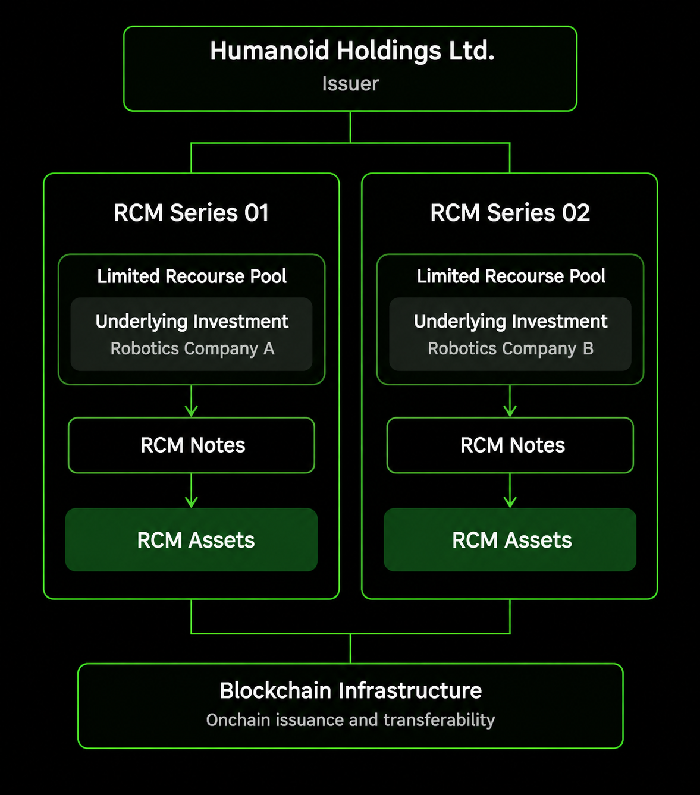

RCM combines a legal investment framework with blockchain infrastructure to represent private robotics investments through onchain financial instruments.

Each investment is structured as a separate Series under the RCM Note Program, with defined economic rights, underlying assets and issuance arrangements.

## Core Architecture

The RCM architecture consists of the following components:

- **Underlying Investment.** The private robotics investment associated with a Series, which may consist of shares or other investment interests held by the Issuer.
- **Issuer.** Humanoid Holdings Ltd. issues the Notes, holds the underlying investments and administers the contractual obligations associated with each Series.
- **RCM Series.** A defined investment arrangement under the RCM Note Program, with its own underlying investment, financial terms and Limited Recourse Pool.
- **RCM Notes.** Financial instruments issued by Humanoid Holdings Ltd. that provide contractual economic exposure to the underlying investment associated with a Series.
- **RCM Assets.** The onchain representations of RCM Notes, designed for transferability and compatibility with blockchain infrastructure.
- **Limited Recourse Pools.** Separate pools of assets and proceeds associated with each Series, establishing the economic resources available to satisfy the obligations under its Notes.

## Legal and Onchain Infrastructure

RCM operates through two complementary layers.

The legal layer establishes the ownership of underlying investments, the issuance of Notes and the contractual economic rights of Noteholders. Each Series is governed by its applicable offering documentation.

The onchain layer uses blockchain infrastructure and [**smart contracts**](https://docs.xmaquina.io/smart-contracts-and-security) to support subscriptions, allocations, Asset issuance, transfers and settlement.

The Securities Ledger records ownership of the Notes in accordance with the applicable legal framework, linking onchain holdings to the contractual rights associated with each Series.

Once transferable, [**RCM Assets**](https://docs.xmaquina.io/understanding-rcm-assets) can be held in compatible wallets, transferred onchain and traded on independent [**secondary markets**](https://docs.xmaquina.io/secondary-markets).

## Investment Separation

Each Series has its own Limited Recourse Pool, underlying investment and associated records.

The assets, proceeds and obligations attributable to each Series are accounted for separately. Noteholders' economic rights are limited to the assets and proceeds available under the applicable Series terms.

This structure allows multiple private robotics investments to be represented through distinct RCM Assets under a common issuance framework.

## Governance and Administration

XMAQUINA develops the RCM Protocol and its supporting infrastructure, while Humanoid Holdings Ltd. acts as the Issuer under the RCM Note Program.

The Issuer administers the underlying investments, issuance arrangements, Securities Ledger and [**distributions**](https://docs.xmaquina.io/realization-distributions) associated with each Series.

The rights and obligations of Noteholders are established by the applicable legal and offering documents.
