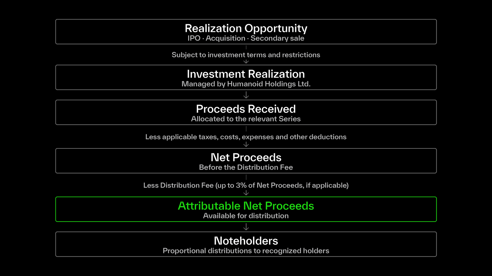

RCM Assets give holders economic exposure to an underlying private investment and the right to participate in the net proceeds realized from that investment, in accordance with the applicable Series terms.

When an underlying investment is realized, Humanoid Holdings Ltd., the Issuer of the Notes, manages the realization and distribution process.

## Investment Realization

Each RCM Series is associated with a specific underlying investment, which may be subject to different investment terms, holding periods and transfer restrictions.

These terms depend on the underlying company, the securities acquired and the structure through which the investment is held.

An investment may be realized through:

- A sale of shares following an initial public offering (IPO).
- An acquisition or merger resulting in proceeds from the underlying investment.
- A secondary sale of the underlying shares.
- Another transaction that results in the realization of the underlying investment.

These are referred to as Liquidity Realization Events.

The timing and manner in which an investment can be realized depend on the applicable investment terms and restrictions.

For example, if an underlying company completes an IPO, the shares held by the Issuer may be subject to a lock-up period before they can be sold. In this case, the IPO itself does not immediately result in a distribution to Noteholders.

## From Realization to Distribution

Although realization terms may differ between investments, the process follows the same general framework:

1. A realization opportunity arises in relation to the underlying investment.
2. The Issuer manages the realization in accordance with the applicable investment terms and restrictions.
3. The proceeds attributable to the relevant Series are received by the Issuer.
4. The net proceeds available for distribution are determined after applicable deductions.
5. Distributions are made to recognized Noteholders in accordance with the applicable Series terms.

In connection with an investment realization, the Issuer may suspend transfers of the corresponding RCM Assets to facilitate the distribution and settlement process.

Following the final realization of the underlying investment and completion of settlement, the Series is concluded in accordance with the Offering Documentation.

## Attributable Net Proceeds

Following realization of the underlying investment, the net proceeds are determined after accounting for applicable taxes, costs, expenses and other deductions in accordance with the Offering Documentation.

A Distribution Fee of up to 3% may apply to the net proceeds, as specified in the applicable Series terms.

The remaining amount available for distribution is referred to as Attributable Net Proceeds.

Noteholders are entitled to their proportional share of the Attributable Net Proceeds, based on their holdings at the applicable Record Date and subject to the required verification and settlement conditions.

For example, assuming a distribution in USDC:

| Distribution details | Amount |
| :-- | :-- |
| Attributable Net Proceeds | 2,000,000 USDC |
| Outstanding Notes | 1,000,000 |
| Distribution per Note | 2.00 USDC |
| Investor's Note holdings | 10,000 |
| Illustrative distribution | 20,000 USDC |

This example assumes that all applicable deductions have already been accounted for and the investor satisfies the relevant distribution requirements.

For more information on applicable fees, see [**Fees & Protocol Economics**](https://docs.xmaquina.io/fees-and-protocol-economics).

## Record Date & Holder Verification

For each distribution, the Issuer establishes a Record Date to determine which Noteholders are entitled to receive the proceeds, based on their holdings recorded on the Securities Ledger.

Holders must satisfy the applicable verification and compliance requirements before receiving a distribution, whether they acquired their RCM Assets through a primary offering or on secondary markets.

The Issuer communicates the applicable Record Date, distribution arrangements and verification requirements through the relevant distribution notice.

For more information, see [**Investor Eligibility**](https://docs.xmaquina.io/investor-eligibility).
